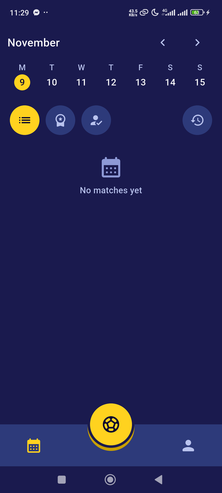
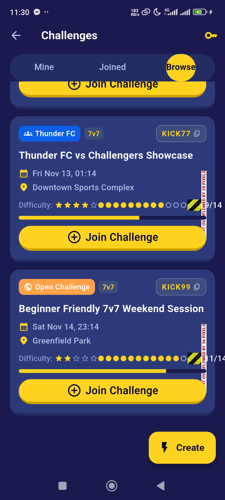
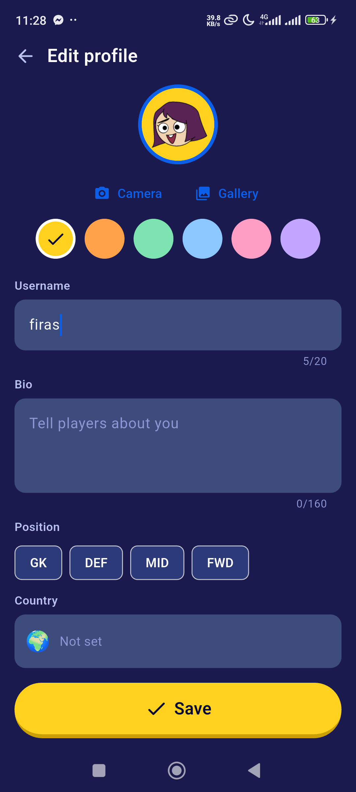
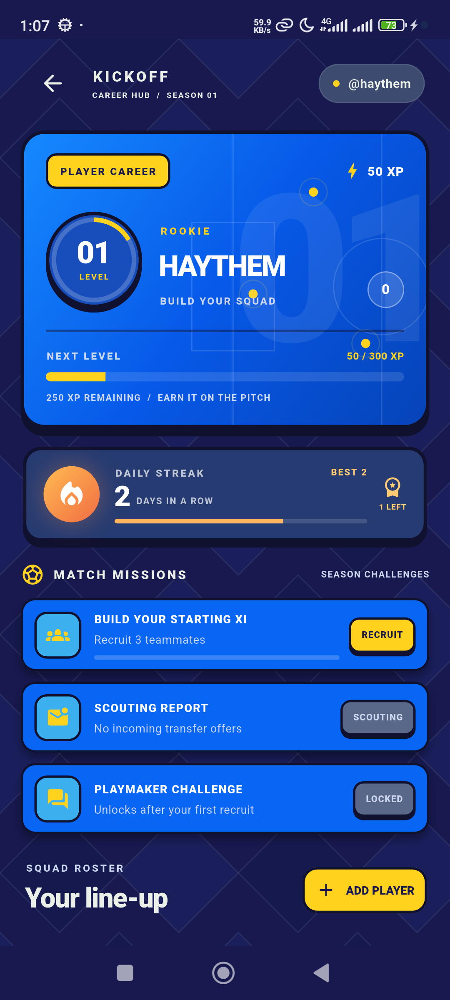
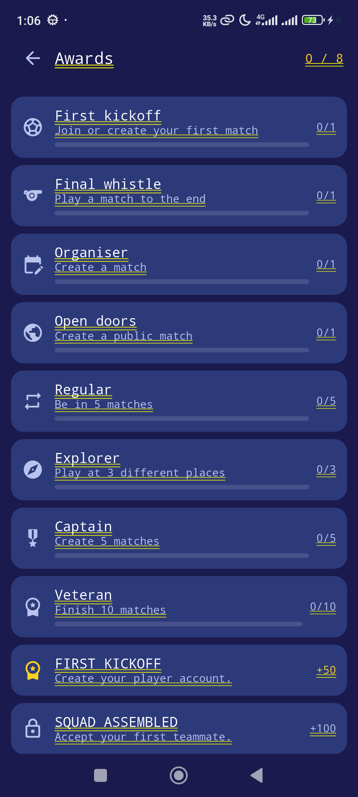

# Kickoff

Kickoff is a Flutter app for organising football with friends: create and join
matches, book real stadiums, challenge other players, run tournaments, chat
with friends and collect awards.

There is **no server to run**. Every player's phone keeps its own SQLite copy
(SQFlite) and shares data through **Firebase** (Authentication + Cloud
Firestore), so the same app installed on several phones shows the same data.

> ESPRIT · 5SAE · Mobile project · Android package `tn.esprit.kickoff`

## Screens

| Home | Calendar | Challenges |
|---|---|---|
|  |  |  |

| Profile | Friends | Awards |
|---|---|---|
|  |  |  |

More in [`docs/screenshots/`](docs/screenshots) and the design prototypes in
[`docs/design/`](docs/design).

## Features

| Module | What players can do |
|---|---|
| **Account** | Sign up with email or Google, choose a unique username, edit the profile (avatar, country, phone), lock the app with biometrics, light/dark theme. Guest mode lets you explore the shell without an account. |
| **Matches** | Create a public or private match (pitch, day, time, players), join with a code, calendar view, weather for the match day. **Search filters**: morning / afternoon / evening / night, a date, an earliest start time. |
| **Stadiums** | Owners add stadiums with pitches, prices and opening hours, block slots, accept or refuse bookings (or turn on auto-confirm). Players book a free slot when creating a match. **Reviews and ratings**: 1–5 stars and a comment, only after booking, one review per player. |
| **Challenges** | Post a challenge for a place and time, join others, sunrise/sunset row, and **travel time to the pitch** (car and walking, from your position). |
| **Tournaments** | Create a tournament (league or knockout), register a team or ask to join one, captain tools, fixtures, results, standings, bracket, stats, notifications. |
| **Friends and chat** | Find players by username, send and accept requests, private chat with friends (yellow chat button on each friend). |
| **Awards** | Achievements and progress kept on the phone. |

## Architecture

```
            ┌──────────────────────────── phone ───────────────────────────┐
 Flutter UI │  views / items ─► services ─► bd (SQFlite)                 │
            │                                         │                    │
            │                       SQFlite  kickoff_local.db (offline)    │
            └─────────────────────────────────────────┼────────────────────┘
                                                      │ push / pull
                                          Firebase Auth + Cloud Firestore
```

- **Offline first.** Lists are read from Firestore and mirrored into SQFlite
  (`DocStore`, plus typed tables for users, matches and challenges). With no
  connection the last copy is shown; writes need a connection.
- **No backend rules on a server.** The business rules that used to live in a
  Dart server (tournament fixtures, join/leave rules, stadium booking, review
  rules) are pure Dart classes in the app: `TournamentRules`,
  `TournamentFixtures`, `StadiumRules`.
- **One document per aggregate.** A tournament and a stadium are each one
  Firestore document (teams, matches, bookings, reviews inside). Changes go
  through `runTransaction`, so a booking or a join is checked and saved in a
  single step and two phones cannot both take the same slot.
- **Swappable services.** Screens talk to small interfaces
  (`TournamentService`, `StadiumApi`, `StadiumDirectory`, `FriendsService`,
  `AccountService`, `ChallengeCloud`, `CloudSync`). `main.dart` plugs in the
  Firestore versions; tests plug in in-memory fakes.
- **Without Firebase** (no config, no network at start) the app falls back to
  no-op services: the shell opens in guest mode and local data still works.

### Firestore collections

| Collection | Content |
|---|---|
| `users/{uid}`, `usernames/{name}` | Profiles and unique usernames |
| `matches/{code}` | Matches by join code |
| `friendRequests`, `friendships`, `chats` | Social graph and chat messages |
| `challenges/{joinCode}` | Challenges |
| `tournaments/{id}`, `tournamentNotifications/{id}`, `meta/tournaments` | Tournaments, their notifications and the id counter |
| `stadiums/{id}`, `stadiumOwners/{ownerId}`, `meta/stadiums` | Stadiums (pitches, blocks, bookings, reviews), owner settings, id counter |

### Free map APIs (no key needed)

| Use | Service |
|---|---|
| Place search | Nominatim (OpenStreetMap) |
| Car travel time | OSRM `router.project-osrm.org` |
| Walking travel time | `routing.openstreetmap.de/routed-foot` |
| Sunrise / sunset, weather | public HTTP APIs, parsed in `lib/services/challenge` and `lib/services/match` |
| Map tiles | `flutter_map` with OpenStreetMap |

## Tech stack

Flutter 3.x / Dart 3.13 · `sqflite` · `firebase_core`, `firebase_auth`,
`cloud_firestore` · `google_sign_in` · `geolocator` · `flutter_map` +
`latlong2` · `local_auth` · `flutter_secure_storage` · `shared_preferences` ·
`image_picker` · `share_plus` · `http`.

## Project layout

```
lib/
  main.dart                 app entry, `routes:` map wiring, Firebase services
  app_routes.dart           route names, route arguments and the routes map
  entities/                 plain classes (toJson / fromJson), no Flutter, no I/O
    user/ match/ stadium/ challenge/ tournament/
  bd/                       SQFlite only: database, tables, CRUD, DocStore, stores
  services/                 everything outside a screen: http, Firestore,
    auth/ friends/ match/   SharedPreferences, rules and controllers
    stadium/ challenge/ tournament/ user/ firebase/ location/ maps/
    security/ settings/ awards/   api_client.dart, http_constants.dart
  views/                    one full page per file
    auth/ home/ user/ friends/ match/ stadium/ challenge/ tournament/ settings/ maps/
  items/                    small reusable widgets used by the views
    match/ stadium/ challenge/ tournament/ user/ awards/ maps/
test/                       mirrors lib/ (test/services, test/views, test/bd, ...)
docs/                       design prototypes, screenshots, tournaments spec
tools/phone.ps1             run on a USB phone (see below)
assets/sample_data.json     optional demo matches and challenges
```

## Getting started

### Requirements

- Flutter with Dart `^3.13.4` (`flutter --version`)
- Android Studio / Android SDK, an emulator or a phone with USB debugging
- A Firebase project (free Spark plan is enough)

### 1. Firebase setup (once)

1. Create a project in the [Firebase console](https://console.firebase.google.com).
2. Add an Android app with package name **`tn.esprit.kickoff`**.
3. Add your debug **SHA-1** (needed for Google sign-in):
   `cd android && ./gradlew signingReport` (Windows: `gradlew.bat signingReport`).
4. Enable **Authentication → Sign-in method**: Email/Password and Google.
5. Create a **Cloud Firestore** database.
6. Download `google-services.json` into `android/app/`. After adding a new
   SHA-1, download it again. The file is not tracked by git.

### 2. Run

```bash
flutter pub get
flutter run                      # emulator or connected phone
flutter run --dart-define=SAMPLE_DATA=true   # also load demo matches/challenges once
```

On Windows with a USB phone, `.\tools\phone.ps1 [-Device <id>]` does the same.
It switches the test-only `sqflite_common_ffi` package off while running,
because it prevents Gradle from packaging `libflutter.so`, and restores
`pubspec.*` when you quit.

### 3. Build an APK for several phones

```bash
flutter build apk --debug       # build/app/outputs/flutter-apk/app-debug.apk
```

Install the same APK on each phone, sign in with different accounts, add each
other as friends and the data is shared through Firestore. Every phone that
uses Google sign-in needs its signing key's SHA-1 registered in Firebase.

## Tests

```bash
flutter analyze
flutter test
flutter test test/services/stadium/stadium_firestore_test.dart   # one file
```

Cloud logic is tested without a network: `InMemoryTournamentStore` and
`InMemoryStadiumStore` replace Firestore, `MockClient` replaces HTTP. SQFlite
runs through `sqflite_common_ffi` on the desktop.

Known red test: `TournamentService reports malformed responses`
(`test/services/tournament/tournaments_test.dart`) belongs to the legacy HTTP client and fails on
`main` too.

## Known limits

- **Firestore is in test mode.** Security rules still allow everything and
  Firebase expires test mode after about 30 days. Before sharing the app,
  write rules for all collections above, or the database will refuse access.
- Lists refresh when a screen loads; they are not live streams, and live
  tournament match updates are not ported.
- Two phones editing the same non-transactional data is last write wins
  (bookings, joins and reviews are transactional).
- Knockout rounds after round one are placeholders (same as the original
  server); tournament player XP and level are placeholders.
- `lib/services/api_client.dart`, `TournamentService` and the old HTTP stadium client
  remain as the base classes and fallback that the Firestore versions
  implement. The Dart server that used to back them has been removed.

## Troubleshooting

| Symptom | Fix |
|---|---|
| Google sign-in fails with `ApiException: 10` | SHA-1 of this machine's debug key is missing in Firebase; add it and download `google-services.json` again. |
| "Can't reach the cloud" | No internet, Firestore not created, or test mode expired. |
| APK build fails around `libflutter.so` | Run through `tools/phone.ps1`, or temporarily comment `sqflite_common_ffi` in `pubspec.yaml`. |
| Chat shows nothing | You can only chat with accepted friends: Profile → Friends → yellow chat button. |
| Travel time says it cannot find the place | The challenge's place name could not be found on the map; use a more precise name. |

## Documentation

- [`docs/tournaments.md`](docs/tournaments.md): tournament rules, bracket
  algorithm and flows.
- [`docs/design/`](docs/design): UI prototypes for the core screens and match
  flow.
- [`tools/README.md`](tools/README.md): phone script and sample data.
- [`AGENTS.md`](AGENTS.md) / [`CLAUDE.md`](CLAUDE.md): conventions for AI
  coding assistants working on this repo.
